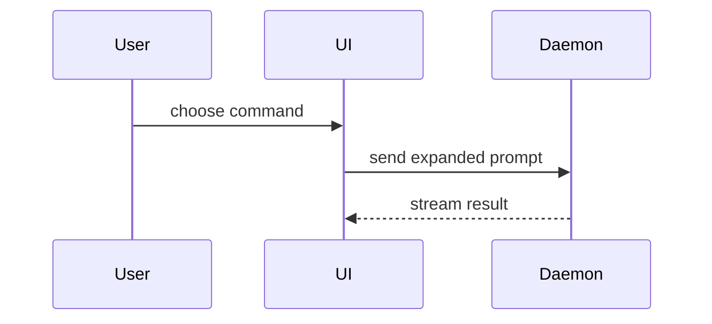

PR 본문을 작성할 때 다음 템플릿을 사용하십시오.

```markdown
## Summary

<diagram, diff-sketch, or tree>

## Evidence

- **Before:** <screenshot/output/failing test run>
  **After:** <screenshot/output/passing test run>

## Merge Danger

**Door:** <one-way or two-way>

<optional: description>

**Blast Radius:** <one-word description>

<optional: potential ramifications of merge>
```

## 섹션

모든 서두는 건너뛰고 산문은 짧게 유지하십시오. `GLOSSARY.md`에 있는 사용자의 도메인 언어를 사용하십시오.

### Summary

핵심 요점을 명확하게 만드는 가장 작은 뷰를 선택하십시오.

- 로직이나 알고리즘은 의사 코드로 보여 주십시오.

```text
on(save)
  if content is unchanged
    return cached result
  write new content
  return fresh result
```

- 런타임 제어 흐름은 호출 트리로 보여 주십시오.

```text
submitForm
  createSession
    persistPrompt
    launchAgent
  navigateToSession
```

- UI 구조는 중요한 상태와 모듈 경계를 포함하여 컴포넌트 트리로 보여 주십시오.

```text
<SessionPage> (apps/example/src/routes/session.tsx)
  useSessionEvents()
  <SessionToolbar>
    <RunSkillButton> (packages/ui)
```

- 파일 책임이나 광범위한 리팩터링은 얕은 파일 트리로 보여 주십시오.

```text
src/
├── commands/       # parses user actions
├── sessions/       # owns session state
└── transport/      # sends API requests
```

- 컴포넌트 상호 작용, 제어 흐름, 또는 데이터 흐름은 Mermaid로 보여 주십시오.



- 요점이 무엇이 바뀌는지이고 주변 형태가 이미 존재할 때는 `diff`를 사용하십시오. diff의 형태를 주제에 맞추십시오.

컴포넌트 변경의 경우:

```diff
 <SessionPage>
   useSessionEvents()
   <SessionToolbar>
+    <RunSkillButton />
   <SessionTimeline>
+    <SkillResultCard />
```

파일 레이아웃 변경의 경우:

```diff
 src/
 ├── commands/
+│   └── show-me.ts       # expands the slash command
 ├── sessions/
-└── transport.ts
+└── transport/
+    ├── client.ts
+    └── stream.ts
```

호출 트리 또는 호출 스택 변경의 경우:

```diff
 submitForm
   createSession
     persistPrompt
+    expandSkillMention
     launchAgent
-  navigateToSession
+  navigateToSession
+    subscribeToEvents
```

상태 또는 제어 흐름 변경의 경우:

```diff
 on(save)
-  write content
+  if content is unchanged
+    return cached result
+  write new content
+  invalidate cache
```

- 대부분이 새로운 내용일 때, 생략된 맥락이 소유권이나 순서를 가릴 때, 또는 사용자가 복사할 수 있는 목표 형태가 필요할 때는 블록 전체를 보여 주십시오.

```ts
function expandSkill(command: string): string {
  const skillName = command.slice(1);
  return `use the ${skillName} skill`;
}
```

#### 지침

각 시각 자료는 그것이 뒷받침하는 짧은 텍스트 옆에 배치하십시오. 사용자의 현재 질문에 답하거나 현재 논의 사항을 해결할 선택지를 제시하는 데 필요한 호출, 파일, prop, 상태, 경계만 남기십시오.

이 중 하나를 사용할 수도, 여러 개를 사용할 수도 있으며, 모두를 사용할 가능성은 낮습니다. 판단력을 발휘하고 사용자를 압도하지 마십시오.

### Evidence

변경이 동작한다는 구체적인 증거입니다. 전과 후를 보여 주십시오.

스크린샷은 S등급입니다. 환경이 갖추어져 있고 변경이 시각적인 경우에 해당합니다.

실행 기반 증거는 A등급입니다. 테스트 결과, 콘솔 출력입니다. 이제 실패에서 통과로 바뀐 정확한 테스트를 의사 코드로 보여 주십시오.

### Merge Danger

일방향 문인지 양방향 문인지 기술하십시오. 양방향 문은 되돌아 나올 수 있지만, 일방향 문은 그럴 수 없습니다. 롤백 비용이 적은 PR은 위험이 낮습니다. 파괴적인 작업이나 되돌리기 어려운 결정이 포함된 변경은 일방향 문입니다.

영향 범위(blast radius)는 이 PR이 도입하는 변경의 잠재적인 영향이나 범위입니다. 모든 가능성을 고려하십시오. 레이아웃 이동, 사용자 측 코드의 파손, 모바일 반응성 등이 그 예입니다.
